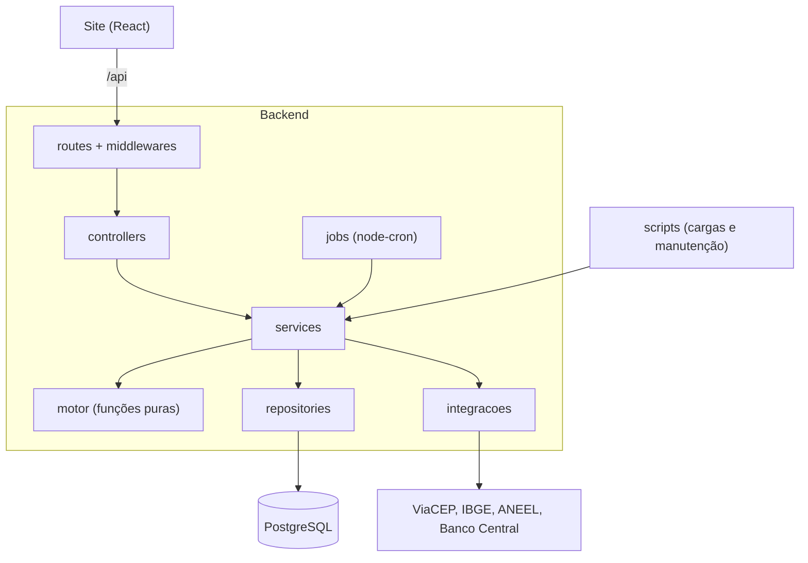

# Arquitetura

O backend é um único processo Node: API REST em Express, agendador de importações e, em produção, a entrega do site. O cálculo fica isolado num motor de funções puras, sem dependência de banco ou framework.



## Camadas

| Camada | Responsabilidade | Regra |
| --- | --- | --- |
| `routes/` | Liga método e caminho aos middlewares e ao controller | Sem lógica |
| `middlewares/` | Autenticação, papéis, validação, limites, erros | Reaproveitados por todas as rotas |
| `controllers/` | Esquemas zod, leitura da entrada e formato da resposta | Não acessa banco |
| `services/` | Regras de negócio | Só eles combinam repositories, integrações e motor |
| `repositories/` | Consultas e gravações | Únicos que usam o Knex |
| `motor/` | Cálculo solar e tarifário | Sem Knex, Express, `fetch` ou `Date.now()` |
| `integracoes/` | Clientes das fontes externas | Sempre por `buscarJson`, validando a resposta com zod |
| `jobs/` | Agenda e lista das importações | A execução fica nos services |

Erros previstos são lançados como `ErroHttp` em qualquer camada acima dos repositories e viram a resposta padrão em `middlewares/erros.ts`:

```ts
throw new ErroHttp(404, 'CLIENTE_NAO_ENCONTRADO', 'Cliente não encontrado.');
```

No Express 5, erros em funções assíncronas chegam sozinhos ao tratador.

## Pastas

```
backend/
├─ knexfile.ts            # conexão e pastas de migrations
├─ migrations/            # migrations do núcleo
├─ scripts/               # migrations, criar-admin, cargas, importar, dados-demo
├─ docs/                  # esta documentação
└─ src/
   ├─ app.ts              # criarApp(): segurança, rotas, erros, sem abrir porta
   ├─ server.ts           # valida o .env, sobe a API e o agendador
   ├─ config/env.ts       # .env validado com zod
   ├─ database/conexao.ts # instância única do Knex
   ├─ tipos/tabelas.ts    # uma interface por tabela
   ├─ parametros/         # parametros.json, tributos-por-uf.json, correcoes-atlas.json e suas validações
   ├─ routes/ controllers/ services/ repositories/
   ├─ middlewares/        # autenticar, validar, limites, erros, frontend
   ├─ integracoes/        # http, viaCep, ibge, ckan, aneel, qualidadeAneel, bancoCentral
   ├─ jobs/               # tipos, lista de jobs, agendador
   ├─ motor/              # cálculo puro
   ├─ utils/              # datas, busca
   ├─ modulos/index.ts    # ponto de extensão
   └─ tests/              # testes, fixtures e contas de luz
```

## Principais serviços

| Serviço | O que faz |
| --- | --- |
| `simulacaoService` | Monta referências e entrada, chama o motor e grava a simulação |
| `refinamento` | Transforma as respostas do cliente em premissas; é cálculo puro |
| `simulacaoFormato` | Arredonda e formata o resultado para a saída |
| `cepService` | CEP → município → distribuidoras possíveis |
| `propostasService` | Regras do ciclo do orçamento |
| `orcamentoCalculo` | Preço, ajustes, condições e snapshot |
| `configuracoesService` | Configuração comercial e formas de pagamento |
| `usuariosService` / `authService` | Regras de usuários; login, token e hash de senha |
| `adminService` | Painel, listas e detalhe do cliente |
| `tarifasAneelService`, `distribuidorasService`, `indicadoresService` | Importações agendadas |
| `municipiosService`, `atlasService` | Cargas por script |
| `importacoesService` | Registra e executa qualquer importação |
| `demonstracaoService` | Dados fictícios de demonstração |

## Caminho de uma requisição

`POST /api/simulacoes`:

1. `helmet`, `cors`, `express.json` e `cookieParser` tratam a requisição.
2. `criarLimite` confere o limite de 30 por minuto por IP.
3. `validar(esquemaSimulacao)` valida o corpo e o troca pela versão convertida, com os números em `Decimal`.
4. O controller calcula o consumo médio e chama `simularEconomia`.
5. O service busca as referências, monta a entrada, chama `simular` e grava o resultado.
6. Qualquer `ErroHttp` no caminho vira a resposta de erro padrão. Um erro não previsto vira `500` genérico, e a pilha fica só no log.

## Decisões de projeto

| Decisão | Motivo |
| --- | --- |
| Motor em funções puras | Testável sem banco e reproduzível a partir do que foi gravado |
| `Decimal` para dinheiro, tarifa e energia | `number` acumula erro de arredondamento em tarifas de 6 casas |
| Simulação lê tarifas só do banco | Uma API externa fora do ar não derruba o simulador, e o resultado é rápido e rastreável |
| Orçamento enviado guarda um snapshot | Reimportar tarifas ou mudar preços não altera o que o cliente recebeu |
| Parâmetros técnicos em JSON no Git | Mudam com revisão e histórico, e valor inválido impede a subida. Valores comerciais ficam no banco, porque quem muda é a gestão |
| Configuração comercial só insere | O histórico de quem mudou o quê é o próprio conjunto de linhas |
| Papel lido do banco a cada requisição | Excluir ou rebaixar um usuário vale na hora, mesmo com a sessão aberta |
| Excluir usuário desativa a conta | A conta segue ligada ao histórico dos orçamentos |
| Distribuidora identificada pelo CNPJ | A sigla muda depois de incorporações |
| Vencida derivada da data, em vez de status | Dispensa um job e não há como ficar dessincronizado |
| Agendador dentro do processo da API | Só uma peça para rodar. Em hospedagem que adormece o serviço, a agenda não dispara ([implantacao.md](implantacao.md#limites)) |
| Site e API na mesma origem em produção | Cookie de sessão e CORS funcionam sem configuração extra |
| Campos desconhecidos sempre recusados | O site não consegue enviar preço ou premissa |
| Simulações guardam o código público (UUID) | O id sequencial não revela quantas existem nem permite percorrê-las |

## Convenções de código

- Nomes em português, claros e completos (`calcularGeracaoMensal`).
- Funções curtas, de até cerca de 40 linhas e uma responsabilidade.
- Comentário explica o porquê (uma regra da Lei 14.300, uma fórmula), não o óbvio. Ele se sustenta sozinho: não depende de documentos externos nem cita caminhos de arquivo.
- Toda entrada (body, query, params) validada com zod. Para body, `validar(esquema)`; para query e params, `lerEntrada(esquema, dados)`, porque o Express 5 não deixa trocar `req.query`.
- Datas em UTC no banco. O fuso `America/Sao_Paulo` só entra no "que dia é hoje" (`hojeEmSaoPaulo`) e no agendador.
- Segredos só no `.env`, nunca no código, nos logs ou nas respostas.

### TypeScript sem etapa de build em desenvolvimento

O Node 22 roda os arquivos `.ts` direto, apagando os tipos. Por isso:

- imports relativos levam a extensão: `import { db } from '../database/conexao.ts'`;
- import só de tipo usa `import type`;
- decimal.js com import nomeado: `import { Decimal } from 'decimal.js'`;
- JSON com atributo: `import dados from './arquivo.json' with { type: 'json' }`;
- nada de `enum`, `namespace` (fora de `declare global`) nem propriedades no construtor.

O `npm run build` acusa qualquer violação.

## Módulos

O núcleo aceita funcionalidades novas sem ser alterado. `src/modulos/index.ts` é o ponto de extensão, hoje sem nenhum módulo registrado.

```
src/modulos/<nome>/
├─ migrations/
├─ routes.ts  controllers/  services/  repositories/  tipos.ts
└─ tests/
```

| Arquivo | O que o módulo acrescenta |
| --- | --- |
| `src/modulos/index.ts` | O router em `routersDosModulos` e os jobs em `jobsDosModulos` |
| `knexfile.ts` | A pasta das migrations em `migrations.directory` |

**Regras de um módulo:**

- Tabelas com o prefixo do módulo (`usina_`, `catalogo_`), nas migrations dele. Pode ter chave estrangeira para o núcleo, nunca o contrário.
- Rotas em `/api/<modulo>/…` (públicas) ou `/api/admin/<modulo>/…` (restritas), com `autenticar` e um dos `exigir…` nas restritas.
- Pode importar do núcleo: `database/conexao.ts`, middlewares, `motor/` e repositories de leitura. Nunca escreve direto em tabelas do núcleo.
- Oferece funções a outros módulos só pelo próprio `publico.ts`.

Como escrever um job de módulo está em [integracoes-e-importacoes.md](integracoes-e-importacoes.md#criar-uma-importação).
