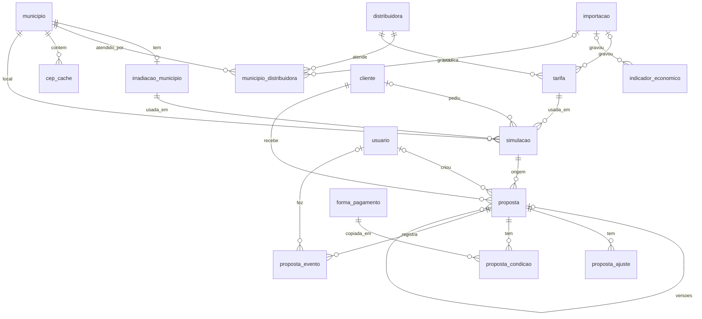

# Banco de dados

PostgreSQL 16 ou mais novo, acessado pelo Knex. Só os repositories usam o Knex; o resto do código não vê SQL.

## Convenções

- Tabelas e colunas em `snake_case`, em português e no singular (`cliente`, `tarifa`).
- Toda tabela tem `id`, `criado_em` e `atualizado_em` (`timestamptz`, em UTC). O fuso de São Paulo só entra na tela e no agendador.
- Dinheiro, tarifa e energia ficam em colunas `numeric`. O driver devolve texto, o repository converte para `Decimal`, e o resto do código só vê `Decimal`.
- Colunas `date` chegam como texto `AAAA-MM-DD` (configurado em `database/conexao.ts`), sem risco de mudar o dia pelo fuso.
- Cada tabela tem uma interface em `tipos/tabelas.ts`, com os tipos que o driver devolve.
- Consultas sempre pelo construtor do Knex, com `.select(...)` de colunas explícitas. `knex.raw` só com parâmetros (`?`), nunca com texto concatenado.
- Operações que gravam em mais de uma tabela usam `db.transaction`.

## Relações



## Tabelas de referência

Alimentadas pelas cargas e importações ([integracoes-e-importacoes.md](integracoes-e-importacoes.md)). O resto do sistema só lê.

| Tabela | Colunas | Observação |
| --- | --- | --- |
| `municipio` | `codigo_ibge` (único, 7 dígitos), `nome`, `uf` (índice) | Os 5.571 municípios do Brasil. É a chave das tabelas por município |
| `irradiacao_municipio` | `codigo_ibge` (único, FK), `hsp_anual`, `hsp_jan` … `hsp_dez` (`numeric(6,3)`) | HSP em horas por dia = Wh/m² por dia ÷ 1000, no plano inclinado igual à latitude |
| `distribuidora` | `cnpj` (único), `sigla`, `nome` | O CNPJ identifica, porque a sigla muda depois de incorporações |
| `municipio_distribuidora` | `codigo_ibge`, `distribuidora_id` (únicos juntos), `conjuntos`, `sugerida`, `importacao_id` | Trocada inteira a cada importação. `sugerida`: a de mais conjuntos no município |
| `tarifa` | `distribuidora_id`, `subgrupo`, `modalidade`, `classe`, `subclasse`, `te_rs_kwh`, `tusd_rs_kwh`, `fio_b_rs_kwh`, `inicio_vigencia`, `fim_vigencia`, `importacao_id` | R$/kWh sem impostos, `numeric(12,6)`. Única por distribuidora + subgrupo + modalidade + classe + subclasse + início: vigência nova é linha nova. `fio_b_rs_kwh` pode ser vazio |
| `indicador_economico` | `serie`, `data` (únicos juntos), `valor`, `importacao_id` | Valores em %. Séries SGS 433, 13522 e 432 |
| `importacao` | `tipo`, `status`, `iniciada_em`, `finalizada_em`, `versao_da_fonte`, `linhas_gravadas`, `mensagem` | Uma linha por execução de cada importação. Também é a trava contra execuções simultâneas |
| `cep_cache` | `cep` (único), `codigo_ibge` (FK) | Só CEP e município, nunca o endereço |

## Clientes e simulações

| Tabela | Colunas | Observação |
| --- | --- | --- |
| `cliente` | `nome`, `email` (índice), `telefone`, `cep`, `aceite_em` (obrigatório), `logradouro`, `numero`, `complemento`, `bairro`, `contato_preferido`, `melhor_horario`, `autoriza_calibracao` | Gravada só pelo pedido de proposta. E-mail em minúsculas e telefone só com números |
| `simulacao` | `codigo` (UUID, único), `cep`, `codigo_ibge`, `tarifa_id`, `irradiacao_id`, `versao_parametros`, `cliente_id` (opcional), `entrada` e `resultado` (JSONB) | Detalhes em [simulacao.md](simulacao.md#o-que-fica-gravado) |

## Orçamentos

| Tabela | Colunas | Observação |
| --- | --- | --- |
| `equipamento` | `tipo` (`modulo`, `inversor`), `fabricante`, `modelo` (únicos juntos), `potencia_w`, `degradacao_anual` (só módulo), `preco`, `ativo` | Catálogo com preço, editado pela gestão |
| `proposta` | `cliente_id`, `simulacao_id`, `status`, `investimento`, `valida_ate`, `snapshot` e `escolhas` (JSONB), `versao`, `proposta_raiz_id`, `observacoes`, `criada_por` | `status`: `rascunho`, `enviada`, `aceita`, `recusada`. `escolhas`: `moduloId`, `inversorId`, `revisao` |
| `proposta_ajuste` | `proposta_id` (cascade), `tipo`, `descricao`, `modo`, `valor` (`numeric(12,4)`), `justificativa`, `criado_por` | Em reais ou fração do preço calculado |
| `proposta_condicao` | `proposta_id` (cascade), `forma_pagamento_id`, `nome`, `tipo`, `taxa_mensal`, `desconto_avista`, `entrada_minima`, `entrada`, `parcelas`, `carencia_dias`, `criado_por` | Guarda a cópia da forma. `entrada` vazia significa a mínima da forma |
| `proposta_evento` | `proposta_id` (cascade), `usuario_id`, `tipo`, `descricao`, `justificativa` | Histórico das ações |

Excluir um rascunho apaga ajustes, condições e eventos junto, por cascade. Orçamento enviado nunca é excluído.

## Usuários e configuração

| Tabela | Colunas | Observação |
| --- | --- | --- |
| `usuario` | `nome`, `email` (único, minúsculo), `senha_hash` (bcrypt, custo 12), `papel` (`admin`, `gestor`, `operador`; padrão `operador`), `ativo` | Nunca sai do backend com `senha_hash`. Excluir desativa: não entra mais, some das listas, segue no histórico e o e-mail não volta a ser usado |
| `configuracao_comercial` | `margem`, `instalacao_por_kwp`, `custo_referencia_por_kwp`, `validade_dias`, `limite_desconto`, `alterado_por` | Só insere: a linha mais recente vale. Valores iniciais em [parametros.md](parametros.md#configuração-comercial) |
| `forma_pagamento` | `tipo` (`avista`, `parcelado`, `financiado`), `nome` (único), `taxa_mensal` (vazia = não definida), `parcelas_minimas`, `parcelas_maximas`, `entrada_minima`, `carencia_maxima_dias`, `desconto_avista`, `ativa`, `alterado_por` | Valores iniciais em [parametros.md](parametros.md#formas-de-pagamento) |

## Migrations

Ficam em `migrations/`, aplicadas em ordem pelo nome do arquivo:

| Arquivo | O que faz |
| --- | --- |
| `20261030235709_cria_usuario` | Tabela `usuario` |
| `20261103021736_cria_tabelas_de_referencia` | `municipio`, `distribuidora`, `importacao`, `tarifa`, `irradiacao_municipio`, `indicador_economico`, `cep_cache` |
| `20261103021738_cria_cliente` | Tabela `cliente` |
| `20261103025645_cria_simulacao` | Tabela `simulacao` |
| `20261103030408_liga_cliente_a_simulacao` | `simulacao.cliente_id` |
| `20261103174919_cria_equipamento_e_proposta` | `equipamento` e `proposta` |
| `20261103181533_cria_municipio_distribuidora` | `municipio_distribuidora`; a distribuidora passa a ser identificada pelo CNPJ |
| `20261104120000_cria_papeis_de_usuario` | Papéis `gestor` e `operador`; coluna `ativo` |
| `20261104120100_cria_configuracao_comercial` | `configuracao_comercial` e `forma_pagamento`, com os valores iniciais |
| `20261104120200_acrescenta_dados_do_cliente` | Endereço, contato e autorização em `cliente` |
| `20261104120300_completa_orcamentos` | Rascunho, versões, `escolhas`, `proposta_ajuste`, `proposta_condicao`, `proposta_evento` |

```
npm run db:migrate                     # aplica as pendentes
npm run db:rollback                    # desfaz o último lote
npm run db:nova-migration -- <nome>    # cria o arquivo
```

**Regras:**

- Toda migration tem `up` e `down`.
- Nunca edite uma migration já aplicada: crie outra.
- Apagar ou renomear uma coluna com dados exige cuidado e aprovação.
- Teste `up`, `down` e `up` de novo numa cópia do banco antes de aplicar em dados reais ([testes.md](testes.md#o-que-precisa-de-banco-real)).

**Atenção ao desfazer:** o `down` de papéis e orçamentos converte dados para caber no esquema anterior. `gestor` e `operador` viram `usuario`, e rascunhos viram `enviada`. Os valores originais não voltam com um novo `up`.

Migrations de módulos ficam na pasta do próprio módulo, registradas em `knexfile.ts` ([arquitetura.md](arquitetura.md#módulos)).
