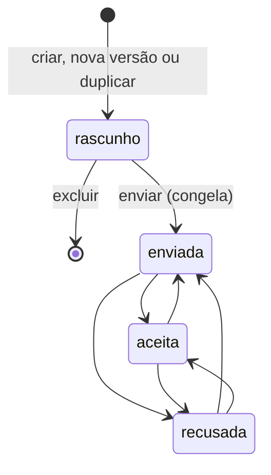

# Orçamentos

A simulação pública é uma estimativa. O orçamento é o documento que a equipe revisa e passa ao cliente: parte de uma simulação com pedido de proposta, usa equipamentos do catálogo e pode receber descontos, acréscimos e condições de pagamento. Na API e no banco, o orçamento se chama `proposta`.

As rotas estão em [api.md](api.md#orçamentos). O código fica em `services/propostasService.ts` (regras), `services/orcamentoCalculo.ts` (cálculo) e `repositories/propostasRepository.ts` (gravação em transação).

## Ciclo de vida



| Status | Significado |
| --- | --- |
| `rascunho` | Em edição. É recalculado a cada alteração e pode ser excluído |
| `enviada` | Congelada. Nada muda além do status |
| `aceita` | O cliente aceitou. Entra em `valorAceitoNoMes` no painel |
| `recusada` | O cliente recusou |

**Vencida não é um status:** é `enviada` com `valida_ate` no passado, e a API devolve `vencida: true`. Assim, não é preciso um job para mudar a situação na virada do dia.

**Fora da validade, nada passa a `aceita`** (`409 PROPOSTA_VENCIDA`), venha o orçamento de `enviada` ou de `recusada`, porque os preços podem ter mudado: o caminho é recusar ou refazer em nova versão. Fora isso, a API aceita trocar entre `enviada`, `aceita` e `recusada`, para corrigir um registro feito por engano. Um aceite dado dentro do prazo continua valendo depois do vencimento.

**O envio não dispara e-mail:** ele registra e congela o orçamento. A entrega ao cliente é feita pela equipe.

## Preço

```
módulos    = preço do módulo × quantidade
instalação = kWp instalado × instalacaoPorKwp
subtotal   = módulos + preço do inversor + instalação
calculado  = subtotal × (1 + margem)
valor final (investimento) = calculado + acréscimos − descontos
```

A quantidade de módulos vem do mesmo dimensionamento do motor, com a potência do módulo escolhido. Preços e configuração são os do dia, sempre no backend.

**Exemplo ilustrativo:** 6 módulos de R$ 800, inversor de R$ 3.000, 3,3 kWp, instalação de R$ 700 por kWp e margem de 20%.

| Item | Conta | Valor |
| --- | --- | --- |
| Módulos | 6 × 800 | R$ 4.800,00 |
| Inversor | | R$ 3.000,00 |
| Instalação | 3,3 × 700 | R$ 2.310,00 |
| Subtotal | | R$ 10.110,00 |
| Calculado | 10.110 × 1,20 | R$ 12.132,00 |
| Desconto de 5% | 12.132 × 0,05 | −R$ 606,60 |
| **Valor final** | | **R$ 11.525,40** |
| À vista com 5% de desconto da forma | 11.525,40 × 0,95 | R$ 10.949,13 |

O orçamento roda o motor com o valor final como investimento. Por isso, payback, VPL e TIR refletem o preço real, e a troca do inversor usa o preço dele no catálogo.

## Rascunho

Toda alteração roda numa transação que trava a proposta, recalcula tudo com a tarifa, os preços e a configuração do dia e grava o novo snapshot. Se o cálculo falhar, nada é gravado.

### Revisão de premissas

A equipe pode trocar módulo e inversor e revisar premissas, sempre com **justificativa**:

| Campo | Faixa | Efeito |
| --- | --- | --- |
| `performanceRatio` | 0,70 a 0,85 | Substitui o PR padrão |
| `simultaneidade` | 0,10 a 0,70 | Substitui a do perfil |
| `telhado` | `horasDeSol`, `orientacao`, `inclinacao` | Tem prioridade sobre as respostas do cliente |
| `quantidadeDeModulos` | 1 a 5.000 | Fixa a quantidade, sem o cálculo e sem o limite de área |

A `revisao` enviada substitui a anterior inteira. As premissas alteradas aparecem como `revisado` em `premissas.origem`. Observações internas não exigem justificativa.

### Ajustes

Descontos e acréscimos, em reais (`modo: valor`) ou em fração do preço calculado (`modo: percentual`, em que 0.05 é 5%).

- Quando a soma dos descontos passa de `limiteDesconto`, ao menos um deles precisa de justificativa (`400 JUSTIFICATIVA_OBRIGATORIA`).
- Ajustes que deixariam o valor final em zero ou menos são recusados (`400 VALOR_FINAL_INVALIDO`).

### Condições de pagamento

A condição guarda uma **cópia da forma** (nome, tipo, taxa, desconto, entrada mínima): mudar a forma depois não altera o orçamento. A forma precisa estar ativa, e parcelas e carência ficam dentro dos limites dela.

| Tipo | Cálculo |
| --- | --- |
| À vista | Total = valor final × (1 − desconto) |
| Parcelado ou financiado | Parcela Price sobre (valor final − entrada), com carência de dias ÷ 30 meses; total = entrada + parcela × parcelas |

- Sem `entrada`, vale a mínima da forma, recalculada quando o valor final muda. A entrada precisa ficar entre a mínima e o valor final (`400 ENTRADA_INVALIDA`).
- `economiaMensalMenosParcela` compara a economia média do primeiro ano com a parcela: mostra se o sistema se paga mês a mês.
- Um novo ajuste refaz todas as condições já escolhidas.

## Envio

Exige ao menos uma condição de pagamento (`422 PROPOSTA_SEM_CONDICAO`). O envio recalcula uma última vez com os dados do dia e congela:

- a validade passa a contar da data do envio, por `validadeDias`;
- `PATCH`, ajustes e condições passam a responder `409 PROPOSTA_CONGELADA`;
- reabrir só lê o snapshot, sem recalcular: mudanças posteriores em tarifa, preço ou configuração não afetam o que foi enviado.

## Snapshot

A coluna `snapshot` guarda tudo o que o orçamento mostra: cliente, equipamentos com preço e quantidade, preços, ajustes, condições, revisão, configuração usada, o resultado do cálculo e a entrada completa do motor. A entrada do motor (`entradaDoMotor`) serve à auditoria e não sai na API.

`estimadoPeloSimulador` guarda o que a simulação pública mostrou ao cliente, para comparar com o valor final.

## Versões e cópias

| Ação | Quando | Resultado |
| --- | --- | --- |
| **Nova versão** | Orçamento fora de rascunho | Rascunho na versão seguinte, apontando para a raiz em `propostaRaizId`. Copia ajustes, condições, revisão e observações, com os valores do dia. A anterior não muda |
| **Duplicar** | Qualquer orçamento | Outro orçamento, na versão 1, para comparar opções |

Cada família de versões tem no máximo um rascunho aberto (`409 RASCUNHO_JA_EXISTE`). Ao criar a cópia, é possível trocar módulo ou inversor.

## Histórico

Cada ação grava uma linha em `proposta_evento`, com quem fez, o que fez e a justificativa, quando houver. Tipos: `criada`, `revisao`, `observacoes`, `ajuste_adicionado`, `ajuste_removido`, `condicao_adicionada`, `condicao_removida`, `enviada`, `nova_versao`, `duplicada` e `status`. O campo `usuario_id` fica vazio nos eventos criados pelo script de demonstração.

## Funil no painel

`GET /admin/painel` resume o trabalho da equipe: quantas simulações viraram pedido, quantos pedidos ainda não têm orçamento (`pedidosNovos`), orçamentos por status, vencidos e o valor aceito no mês.

O valor aceito soma os orçamentos em `aceita` cuja última atualização foi no mês corrente, no fuso de São Paulo.
